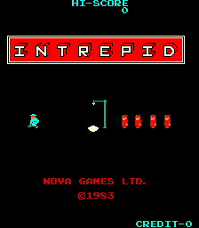
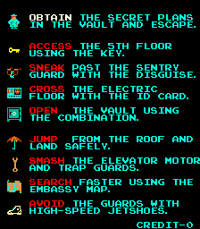
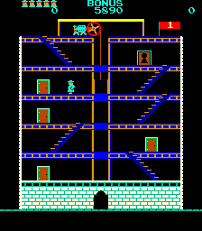

# Intrepid for MiSTer

## Overview

FPGA implementation of **Intrepid**, originally released by Nova Games in 1983.

Current status: functional behavioural implementation, mainly based on MAME/reference behaviour.

The core supports native game timing, portrait screen orientation, background scrolling, sprites, sound, controls and high-score persistence.

## How this core was developed

This core was developed with the help of AI coding tools, which I used to write the code where my own experience fell short. Its current behaviour is largely based on MAME.

I have not been able to find a manual or schematics for Intrepid, so this core is based on MAME only. If documentation turns up, I will use it to bring the core closer to the original hardware.

## Screenshots

| | |
| --- | --- |
|  |  |
|  | |

## Installation

1. Copy `releases/Arcade-Intrepid_20260927.rbf` to `/_Arcade/cores/`, renaming it to `Intrepid_20260927.rbf`.
2. Copy `releases/Intrepid (set 1).mra` to `/_Arcade/`.
3. Supply your legally obtained `intrepid.zip` in `/games/mame/` and launch the MRA.

**Important:** Move older Intrepid RBFs outside `/_Arcade/cores/` before installing this release to avoid loading the wrong version.

No ROMs are included. The MRA uses the `intrepid` parent ROM set.

For additional information, see the [MiSTer Arcade ROM guide](https://github.com/MiSTer-devel/Main_MiSTer/wiki/Arcade-Roms).

## Controls and settings

The core supports movement, diagonal movement, Action, Coin, Start 1 and Start 2.

Player 2/cocktail controls are supported as implemented.

Use MiSTer's **Define joystick buttons** menu to assign the dedicated **Pause** button.

Pause is separate from the Action button and can be enabled through the core OSD.

OSD options include game DIP switches, Pause and Autosave Hiscores.

**Pause and Autosave Hiscores are disabled by default.**

During high-score initials entry, the original game requires Action to remain pressed briefly. Very short button presses may appear to require a second press.

## Autosave Hiscores

The core supports optional high-score persistence.

When **Autosave Hiscores** is enabled, the following information is preserved:

- All ten leaderboard entries.
- Player initials.
- The independent HI-SCORE value displayed at the top of the screen.

High scores are restored after restarting the core or performing a Soft Reset.

The NVRAM file is stored at:

`/media/fat/config/nvram/Intrepid (set 1).nvm`

The file contains a 63-byte payload.

**Note:** Autosave Hiscores must be enabled in the OSD for automatic score saving.

## Credits and licences

**GPL-3.0-or-later covers the project owner's original contributions only.**

Inherited material retains its own terms and notices.

| Component | Credits | Applicable terms / reference |
|---|---|---|
| Intrepid-specific RTL, Pause, Autosave Hiscores, tests and documentation | harlock74 | Scoped [owner grant](LICENSE) |
| MiSTer framework, video/scaler, memory and host infrastructure | MiSTer Template contributors | Retained GPL/LGPL, TEMLIB and component-specific notices |
| TV80 Z80 CPU | Guy Hutchison, based on T80 by Daniel Wallner | Retained permissive notice and disclaimer |
| Intel/Altera PLL and reconfiguration IP | Intel / Altera | Original vendor notices and device-use restrictions |
| Intrepid and AY functional reference | MAME contributors | Reference implementation; AY BSD-3-Clause attribution retained |

For full third-party notices, licensing details and source provenance, see [NOTICE.md](NOTICE.md), [LICENSE](LICENSE), [third-party source documentation](docs/THIRD_PARTY_SOURCES.md), and the accompanying `LICENSES/` directory.

Game ROMs and other copyrighted game assets are not distributed.

## Building the core

The project targets the Cyclone V **5CSEBA6U23I7** FPGA and uses **Quartus Prime Lite 17.0.2 Build 602**.

Open `Arcade-Intrepid.qpf` in Quartus and select **Full Compilation**.

Alternatively, from the project directory, run:

`quartus_sh --flow compile Arcade-Intrepid -c Arcade-Intrepid`

Required source files, IP, constraints and generator scripts are included in the repository.

The supplied release RBF is the previously tested build. A newly compiled RBF should be tested independently before distribution.

**Release SHA-256:**

`Arcade-Intrepid_20260927.rbf`

`c9b126829391102792fe589d92bb592c528ea146dccdeb319bd0b9e09305ed3c`